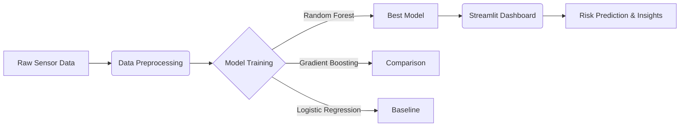

# Predictive Vehicle Maintenance Analytics System

## 🚗 Overview
This project is an end-to-end Machine Learning pipeline designed to predict elevated maintenance risk for vehicles based on simulated sensor and telemetry data. It demonstrates professional software engineering and data science practices.

## 🎯 Problem Statement
Given historical vehicle sensor and operating data, can we identify vehicles or operating conditions associated with elevated maintenance risk?

The system serves as a predictive maintenance tool, helping to flag vehicles that require inspection before mechanical failures occur.

**Note:** This is a portfolio/research prototype. It does not diagnose actual mechanical faults or replace professional vehicle inspection.

## 🏗️ Architecture


## 📊 Dataset
- **Source:** Synthetically generated realistic vehicle telemetry data.
- **Size:** 10,000 records
- **Features:** 
  - `vehicle_type` (Categorical)
  - `operating_hours` (Numeric)
  - `engine_temperature` (Numeric)
  - `rpm` (Numeric)
  - `vehicle_speed` (Numeric)
  - `oil_pressure` (Numeric)
  - `vibration_level` (Numeric)
  - `battery_voltage` (Numeric)
- **Target:** `maintenance_risk` (0: Low Risk, 1: High Risk)

## ⚙️ Methodology
### 1. Data Preprocessing & Feature Engineering
- **Missing Values:** Median Imputation (Numerical) and Mode Imputation (Categorical).
- **Feature Engineering:** Calculated `temp_rpm_ratio`, `voltage_drop`, and `is_high_vibration` to capture non-linear degradation signals.
- **Scaling:** Standardized numerical features using `StandardScaler`.
- **Encoding:** One-hot encoded categorical features (`vehicle_type`).

### 2. Model Selection & Training
Models evaluated:
1. Logistic Regression (Baseline)
2. Random Forest
3. HistGradientBoostingClassifier

Models were trained using an 80/20 train/test split with stratification to handle the class imbalance.

### 3. Evaluation Metrics (Test Set Results)
The **Random Forest** model was selected as the final model due to its high F1-score on the positive class (maintenance risk).

- **ROC-AUC:** 0.992
- **Precision (High Risk):** 0.839
- **Recall (High Risk):** 0.925
- **F1-Score:** 0.880

*Note: High recall is prioritized in predictive maintenance to minimize false negatives (failing to predict a needed maintenance).*

## 💻 Prediction Interface
A Streamlit dashboard is provided for live predictions and model interpretability.
It allows users to input sensor values and get:
- Predicted Risk Category (LOW/HIGH)
- Probability of maintenance requirement
- Feature Importance visualizations

## 🚀 Installation & Usage

### 1. Create Virtual Environment & Install Dependencies
```bash
python3 -m venv .venv
source .venv/bin/activate
pip install -r requirements.txt
```

### 2. Prepare Data
```bash
python scripts/generate_synthetic_data.py
python scripts/prepare_data.py
```

### 3. Train & Evaluate Models
```bash
python scripts/train_model.py
python scripts/evaluate_model.py
```

### 4. Run Tests
```bash
pytest -q tests/
```

### 5. Launch Streamlit Dashboard
```bash
streamlit run app.py
```

## 📁 Project Structure
```text
predictive-vehicle-maintenance/
├── app.py                      # Streamlit dashboard
├── data/                       # Raw and processed datasets
├── models/                     # Saved preprocessor and trained models
├── results/                    # Generated figures and metrics
├── scripts/                    # Execution scripts
├── src/                        # Core source code modules
├── tests/                      # Pytest unit tests
├── requirements.txt            # Python dependencies
└── README.md                   # Project documentation
```

## ⚠️ Limitations & Future Improvements
- **Limitations:** The dataset is synthetic. While it models realistic interactions, real-world sensor data includes much more noise, temporal dependencies, and missing data chunks.
- **Future Improvements:** 
  - Incorporate sequential/time-series modeling (LSTMs/Transformers).
  - Use real-world telemetry datasets.
  - Implement a REST API using FastAPI.

## 🛡️ Privacy and Security
This project uses synthetic data. No personal vehicle data is stored or processed.

## 📄 License
MIT License
